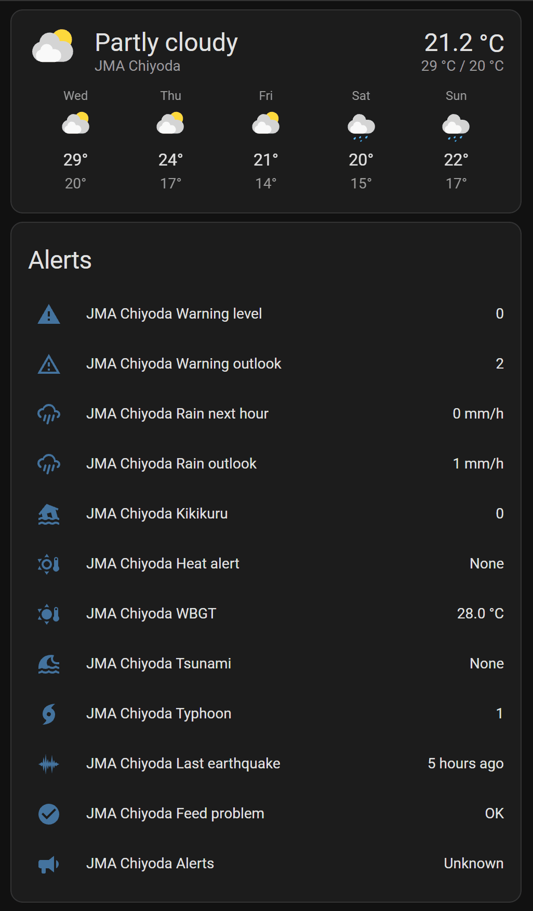
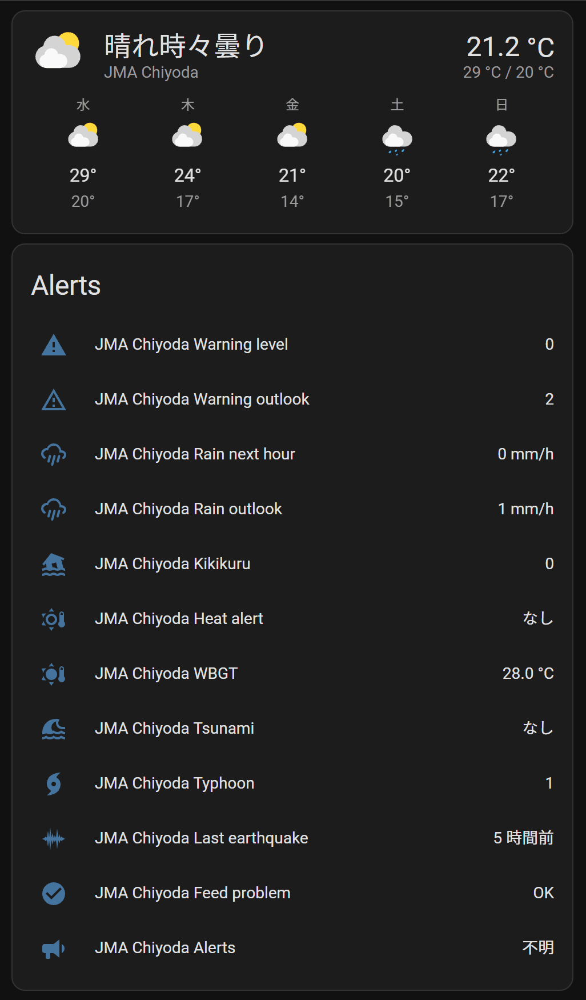
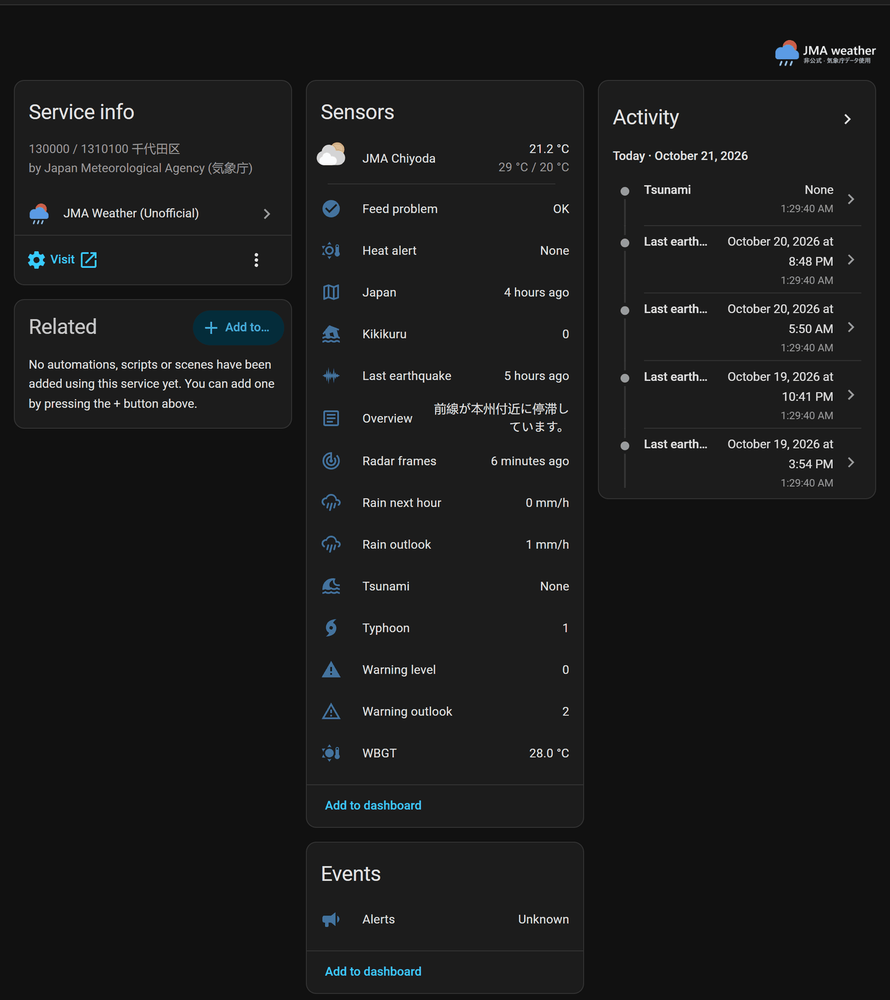
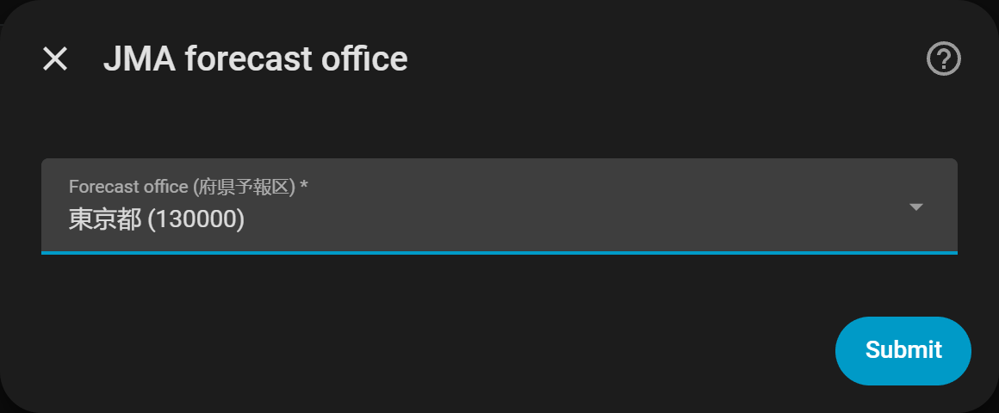
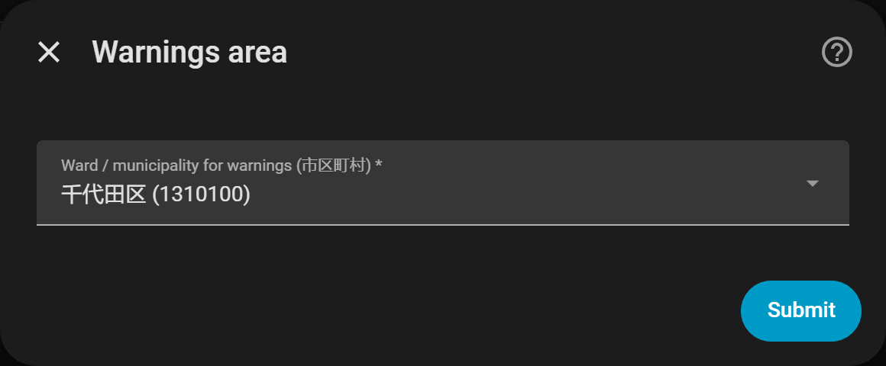
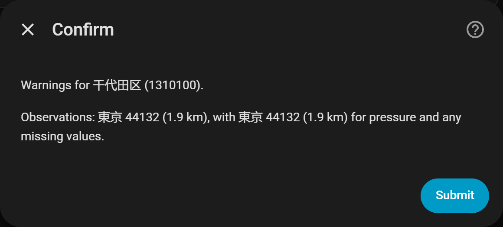
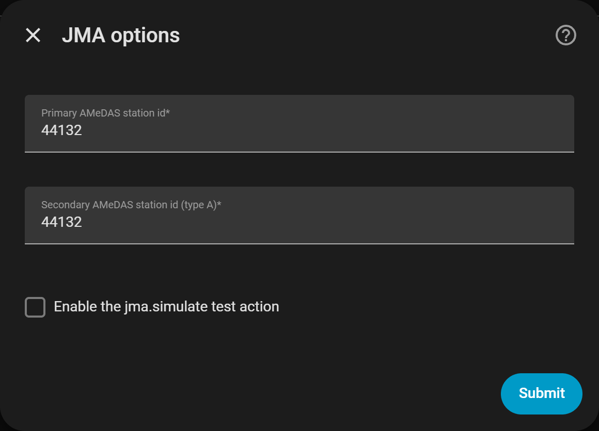

<p align="center">
  
</p>

<p align="center">
  <a href="https://github.com/glockpete/ha-jma/releases/latest"></a>
  <a href="https://github.com/glockpete/ha-jma/actions/workflows/validate.yml"></a>
  <a href="https://github.com/glockpete/ha-jma/actions/workflows/tests.yml"></a>
  <a href="https://github.com/hacs/integration"></a>
  
  <a href="https://github.com/glockpete/ha-jma/blob/main/LICENSE"></a>
</p>

<p align="center">
  English · <a href="https://github.com/glockpete/ha-jma/blob/main/README.ja.md">日本語（概要）</a>
</p>

# JMA Weather (Unofficial)

Weather forecasts, warnings, rain radar, typhoons, earthquakes, tsunami information, volcanic alert levels and
heat-stroke alerts for **any place in Japan**, in Home Assistant.

The integration connects Home Assistant to the public files of
[気象庁 (the Japan Meteorological Agency, JMA)](https://www.jma.go.jp/) and to a few other public services. These
services are listed in [Data sources and attribution](#data-sources-and-attribution). You need no account and no
API key.

> **Important.** This is a community project. JMA did not make it, does not endorse it and does not support it.
> **Do not use it for evacuation or safety decisions, and do not rely on it as your only way to learn of a
> danger.** It is a convenience for automations, not a warning system.

<p align="center">
  <a href="https://my.home-assistant.io/redirect/hacs_repository/?owner=glockpete&repository=ha-jma&category=integration"></a>
  &nbsp;
  <a href="https://my.home-assistant.io/redirect/config_flow_start/?domain=jma"></a>
</p>

**Quick start**

1. [Install](#install) the integration with HACS and restart Home Assistant.
2. [Set up](#set-up) a place: choose the forecast office and the municipality. Nothing else is asked.
3. Use the [entities](#entities) on a dashboard, and trigger automations on `event.jma_<place>_alerts`
   (see [Use it in automations](#use-it-in-automations)).

For help, see [Troubleshooting](#troubleshooting) and
[Reporting problems and contributing](#reporting-problems-and-contributing).

## Contents

- [Screenshots](#screenshots)
- [Features](#features)
- [Install](#install)
- [Set up](#set-up)
  - [What the dialogs ask](#what-the-dialogs-ask)
  - [More than one place](#more-than-one-place)
  - [Names and entity ids](#names-and-entity-ids)
  - [Options](#options)
  - [Reconfigure](#reconfigure)
  - [When the home moves](#when-the-home-moves)
  - [When JMA cannot be reached](#when-jma-cannot-be-reached)
- [Entities](#entities)
  - [Weather and warnings](#weather-and-warnings)
  - [Rain and maps](#rain-and-maps)
  - [Storms and heat](#storms-and-heat)
  - [Volcanoes](#volcanoes)
  - [Earthquakes and tsunami](#earthquakes-and-tsunami)
  - [Alerts and status](#alerts-and-status)
  - [Disabled and diagnostic entities](#disabled-and-diagnostic-entities)
- [Events](#events)
  - [Warnings and rain](#warnings-and-rain)
  - [Earthquakes](#earthquakes)
  - [Tsunami](#tsunami)
  - [Typhoons and heat](#typhoons-and-heat)
  - [Volcano levels](#volcano-levels)
  - [After a restart](#after-a-restart)
- [Use it in automations](#use-it-in-automations)
  - [Example automations](#example-automations)
  - [Test your automations](#test-your-automations)
- [Earthquake values](#earthquake-values)
- [Update intervals](#update-intervals)
  - [How the feed-problem sensor judges a feed](#how-the-feed-problem-sensor-judges-a-feed)
- [Known limitations](#known-limitations)
- [Troubleshooting](#troubleshooting)
- [Repair issues](#repair-issues)
- [Removing the integration](#removing-the-integration)
- [Data sources and attribution](#data-sources-and-attribution)
- [Privacy](#privacy)
- [Quality scale](#quality-scale)
- [Reporting problems and contributing](#reporting-problems-and-contributing)
- [Licence](#licence)

## Screenshots

<table>
  <tr>
    <td width="50%"></td>
    <td width="50%"></td>
  </tr>
  <tr>
    <td align="center"><sub>Weather card and alert sensors, English interface</sub></td>
    <td align="center"><sub>The same dashboard, Japanese interface</sub></td>
  </tr>
</table>

<p align="center">
  
  <br><sub>The device page shows every entity of one place. Taken with version 0.6 on a Home Assistant 2026.9.4
  test instance, with data from JMA's servers. The volcano sensor, added in 0.8, is not in the picture.</sub>
</p>

<table>
  <tr>
    <td width="50%"><a href="https://github.com/glockpete/ha-jma-card"></a></td>
    <td width="50%"><a href="https://github.com/glockpete/ha-jma-card"></a></td>
  </tr>
  <tr>
    <td colspan="2" align="center"><sub>The companion dashboard card,
    <a href="https://github.com/glockpete/ha-jma-card">JMA Weather Card (Unofficial)</a>, in a light and a dark theme</sub></td>
  </tr>
</table>

## Features

- **Weather.** Current conditions from AMeDAS (JMA's automatic weather stations) and the rain nowcast, a daily
  forecast from JMA, and an hourly forecast from Open-Meteo (JMA's MSM, the Meso-Scale Model).
- **Warnings for your municipality.** A sensor with the highest warning level in force: 0 when nothing is in force,
  2 for an advisory, 3 for a warning, 4 for a danger warning and 5 for an emergency warning. These are the numbers
  of JMA's 警戒レベル; a warning that JMA gives no level number gets the number of its kind. There is also a
  3-hourly outlook, and events when a warning is issued, raised, lowered or cleared.
- **Rain.** The heaviest rain expected at your home in the next hour (5-minute nowcast), the rain outlook for the
  hours after that, and the キキクル risk level (JMA's landslide, flood and inundation risk map).
- **Typhoons.** Every active storm with its track, wind, pressure and distance, and an alert when one is forecast
  to come near your home.
- **Earthquakes.** The strongest shindo (震度, the Japanese intensity scale) in your prefecture and in your
  municipality, and early warnings (緊急地震速報) as events. In the 23 special wards of Tokyo, the earthquake
  events follow the 23 wards, not the whole prefecture.
- **Tsunami.** The tsunami grade for your coast as a sensor, and events.
- **Heat stroke.** The Ministry of the Environment's heat-stroke alerts (熱中症警戒アラート, heat-stroke alert, and
  熱中症特別警戒アラート, special heat-stroke alert), and the forecast heat index (WBGT,
  wet-bulb globe temperature) at the nearest of the Ministry's points, in every prefecture.
- **Volcanoes.** The highest 噴火警戒レベル (volcanic alert level) among the volcanoes that concern your place, as a
  sensor with the volcanoes listed, and an event when one of those levels changes.
- **Map layers.** Frame lists for rain radar and other JMA map layers, and the flood layer of the national
  hazard map, for map cards on a dashboard.
- **Health.** A feed-problem sensor, repair issues for a missing earthquake connection or a silent weather station,
  and a diagnostics download that hides your location.
- **Languages.** The interface text is in English and Japanese.
- **Dashboard card.** [JMA Weather Card (Unofficial)](https://github.com/glockpete/ha-jma-card) shows the forecast,
  warnings, rain in the next hour, the radar loop, earthquakes, tsunami, typhoons and heat in one card. It is a
  separate HACS download (category Dashboard).

## Install

### Requirements

- Home Assistant 2026.9.0 or newer. Older versions were not tested.
- Your home location set in Home Assistant (**Settings > System > General**). The integration uses it for the rain
  values, the hourly forecast, the typhoon and volcano distances and the choice of the nearest stations.
- Internet access to the services in [Data sources and attribution](#data-sources-and-attribution).

The integration installs no extra Python packages and needs no account or API key.

### Install with HACS

1. Open this repository in HACS with the badge below.

   <a href="https://my.home-assistant.io/redirect/hacs_repository/?owner=glockpete&repository=ha-jma&category=integration"></a>

   Alternatively, open the three-dot menu in HACS, select **Custom repositories**, enter
   `https://github.com/glockpete/ha-jma`, select the type **Integration** and select **Add**. Then search HACS for
   **JMA Weather (Unofficial)** and open it.
2. Download **JMA Weather (Unofficial)**.
3. Restart Home Assistant.
4. Continue with [Set up](#set-up).

### Install by hand

1. Download `jma.zip` from the [latest release](https://github.com/glockpete/ha-jma/releases/latest) and unzip it
   into a folder named `custom_components/jma` in your Home Assistant configuration directory. Alternatively, copy
   this repository's folder `custom_components/jma` into the `custom_components` folder of that directory. Either
   way, `manifest.json` ends up at `custom_components/jma/manifest.json`.
2. Restart Home Assistant.
3. Continue with [Set up](#set-up).

### Update

HACS shows a new release as an update. Install it and restart Home Assistant. The changes of each release are in
the [changelog](https://github.com/glockpete/ha-jma/blob/main/CHANGELOG.md).

## Set up

1. Start the set-up with the badge below, or go to **Settings > Devices & services > Add integration** and select
   **JMA Weather (Unofficial)**.

   <a href="https://my.home-assistant.io/redirect/config_flow_start/?domain=jma"></a>
2. **Choose the forecast office (府県予報区).** This is JMA's forecast office for your prefecture or region. The
   list shows `name (code)`, for example `東京都 (130000)` (Tokyo). The first two digits of the code give the
   prefecture.
3. **Choose the municipality (市区町村).** Warnings and local earthquake values are for this municipality. The list
   shows the municipalities of the office you chose, for example `千代田区 (1310100)` (Chiyoda ward).
4. **Confirm.** The dialog shows the municipality and the two weather stations chosen for you:
   - the nearest AMeDAS station that measures temperature, and
   - the nearest type-A station (a station that also measures air pressure), used for air pressure and for any
     value the first station lacks.

   There is nothing to fill in. Submit to finish.

<details>
<summary>The set-up dialogs</summary>







</details>

### What the dialogs ask

| Dialog | Field | Help text under the field |
|---|---|---|
| JMA forecast office | Forecast office (府県予報区) | The prefecture-level forecast office that publishes the forecast and warnings for your area. |
| Warnings area | Ward / municipality for warnings (市区町村) | The ward or municipality the warnings are read for, from the list of that forecast office. |
| Confirm | none | |

The **Confirm** dialog says:

> Warnings for 千代田区 (1310100).
>
> Observations: 東京 44132 (1.9 km), with 東京 44132 (1.9 km) for pressure and any missing values.

Each station is shown as its name, its id and its distance from your home. The example is for a home at Tokyo
Station (35.6812, 139.7671). There one station is both the nearest temperature station and the nearest type-A
station, so it is named twice.

A set-up can stop with one of these messages:

| Message | Key | When |
|---|---|---|
| Could not reach the Japan Meteorological Agency's server. | `cannot_connect` | JMA's area list or station table could not be fetched, or was not in the shape the integration reads. |
| This area is already set up. | `already_configured` | The municipality you chose already has an entry. |
| A setup for this area is already in progress. | `already_in_progress` | Another set-up dialog for the same municipality is open. |

Both lists come from JMA's area list, <https://www.jma.go.jp/bosai/common/const/area.json> (`offices` for the
forecast office, `class20s` for the municipality). The station ids are in
<https://www.jma.go.jp/bosai/amedas/const/amedastable.json>.

### More than one place

You can add more places the same way. Each municipality can be set up once.

A second place gives you that place's forecast, warnings, earthquake values, tsunami grade, heat-stroke alert and
volcano bulletins: these follow the forecast office and the municipality you choose. The values below always follow
**the home location of Home Assistant**, whichever municipality the entry is for:

- the two weather stations picked at set-up, and so the measured values of the weather entity (temperature,
  humidity, pressure and wind). The weather entity's condition is the forecast of the chosen place, but it turns
  to rainy or pouring while the nowcast shows rain at the home;
- the high and low temperatures of the daily forecast and their normals, which JMA gives per station and which
  are read for the second of the two stations, and the `wbgt_home` attribute of the heat-alert sensor, which is
  read for the two stations (you can enter other station ids under [Options](#options));
- the rain in the next hour, the rain outlook and the キキクル level;
- the hourly forecast;
- the typhoon distance and approach stage;
- the heat-index (WBGT) point, which is the point of the entry's prefecture nearest to the home;
- the distance rule of the volcano sensor.

So an entry for a municipality far from your home shows that municipality's forecast and warnings next to your
home's observations and rain. The distances in the **Confirm** dialog are measured from the home too.

At most two places per home receive earthquake and tsunami information (see
[Known limitations](#known-limitations)).

### Names and entity ids

The entry is named **JMA** and the English name of the municipality without the word City, Ward, Town or Village,
for example `JMA Chiyoda`. The entity ids follow that name, for example `weather.jma_chiyoda` and
`sensor.jma_chiyoda_warning_level`. You can rename the entry in the UI.

The name is chosen once, when you add the place. An existing entry keeps its name, and
[Reconfigure](#reconfigure) does not change it.

**Two municipalities with one name.** In JMA's area list, 102 English names belong to more than one municipality.
Chuo, for example, is a ward of Tokyo and a city in Yamanashi. Two entries with the same title would get the same
device name and entity ids ending in `_2`. So a shared name is followed by the forecast office in brackets:

| Municipality | Title | Entity id of the weather entity |
|---|---|---|
| Chuo, Tokyo | `JMA Chuo (Tokyo)` | `weather.jma_chuo_tokyo` |
| Chuo, Yamanashi | `JMA Chuo (Yamanashi)` | `weather.jma_chuo_yamanashi` |

Two more rules:

- **The largest kind of municipality keeps the plain name** when every other municipality with that name is a
  smaller kind (a city or ward is larger than a town, and a town is larger than a village). Chiyoda ward in Tokyo
  (JMA's English name for it is Chiyoda City) stays `JMA Chiyoda`. Chiyoda Town in Gunma becomes
  `JMA Chiyoda (Gunma)`.
- **The whole English name is used** where two municipalities of one office still share the short name. Fuchu City
  and Fuchu Town, both in Hiroshima, become `JMA Fuchu City (Hiroshima)` and `JMA Fuchu Town (Hiroshima)`.

The entry also stores the Japanese name of the municipality. The earthquake values use it to match station
addresses (see [Earthquake values](#earthquake-values)).

### Options

Open the entry (**Settings > Devices & services > JMA Weather (Unofficial)**) and select **Configure**. The dialog
is titled **JMA options**. Each field starts with the value the entry uses now.

<details>
<summary>The options dialog</summary>



The picture was taken with version 0.6. The field **Volcano distance (km)**, added in 0.8, is not in it.

</details>

| Field | Help text under the field |
|---|---|
| Primary AMeDAS station id | The nearest AMeDAS station that measures temperature; its readings come first. |
| Secondary AMeDAS station id (type A) | The nearest type A station, used for pressure and for any value the primary station does not report. |
| Volcano distance (km) | A volcano bulletin that names no municipality counts for the volcano sensor when the volcano is within this distance of Home Assistant's home. A bulletin that names municipalities counts when yours is one of them, whatever the distance. 0 turns the distance rule off. See [Volcanoes](#volcanoes). |
| Enable the jma.simulate test action | Lets the jma.simulate action fire test alerts at this entry; leave it off in normal use. See [Test your automations](#test-your-automations). |

What happens when you submit:

1. The integration tidies each station id. It removes the spaces around it and turns full-width digits, as a
   Japanese input method types them (`４４１３２`), into ASCII digits.
2. The id must be five digits. If not, the field shows "An AMeDAS station id is five digits, for example 44071."
   (`invalid_station`).
3. The id is looked up in JMA's station table, <https://www.jma.go.jp/bosai/amedas/const/amedastable.json>. If it
   is not there, the field shows "No AMeDAS station has this id in the agency's table. Check the id, for example
   44071." (`unknown_station`).
4. Both station fields can show an error at once. Nothing is saved until both are right, and what you typed stays
   in the field.
5. Saving reloads the entry when a setting has changed, so the new stations apply.

If JMA's station table cannot be fetched, or is not in the expected shape, the ids are accepted as typed after the
five-digit check. JMA being down does not stop you from saving. A wrong id saved that way shows up later, as a
silent station (see [Repair issues](#repair-issues)).

A station id saved here replaces the station picked at set-up. [Reconfigure](#reconfigure) drops the typed id and
picks the nearest stations again.

The volcano distance is a whole number of kilometres from 0 to 500. A form submitted without it uses the default of
50 km. [Reconfigure](#reconfigure) keeps it.

### Reconfigure

Use **Reconfigure** when a weather station has closed or changed its id, or when you want the nearest stations
picked again.

1. Go to **Settings > Devices & services > JMA Weather (Unofficial)**.
2. Open the three-dot menu of the entry and select **Reconfigure**.
3. The dialog is titled **Pick the stations again**. It has no field. It says:

   > Warnings stay for 千代田区 (1310100).
   >
   > The agency's tables now give: observations from 東京 44132 (1.9 km), with 東京 44132 (1.9 km) for pressure and
   > any missing values.
   >
   > Submit to use these stations and refresh the area names. A station id typed under Configure is replaced.

4. Submit.

What it does:

- It fetches JMA's area list and station table again and picks the two AMeDAS stations nearest to the home of
  Home Assistant, the way set-up does.
- It refreshes the area names stored in the entry. An entry made before version 0.6 gains its Japanese area name
  this way.
- The municipality and the entry title do not change. If you renamed the entry, the name stays.
- A station id typed under Configure is dropped, so that the picked stations apply. The volcano distance and the
  setting **Enable the jma.simulate test action** stay as they were.
- The entry reloads by itself if it is loaded and a setting has changed.

It ends with one of these messages:

| Message | Key | When |
|---|---|---|
| The stations and names were updated. | `reconfigure_successful` | Done. |
| This entry does not belong to the area it was made for. Add the area again instead. | `unique_id_mismatch` | The unique id of the entry is not the area code stored in it. |
| Could not reach the Japan Meteorological Agency's server. | `cannot_connect` | JMA's area list or station table could not be fetched, or was not in the expected shape. Nothing is changed. |

### When the home moves

The rain nowcast, the キキクル and rain-outlook values, the hourly forecast and the typhoon distance are read for
the home location of Home Assistant. If you change the latitude or longitude in **Settings > System > General**, the
entry reloads by itself and uses the new place. No restart is needed, and the rain values follow. Saving the same
place again, or changing something else in that dialog (units, time zone, name or elevation), does not reload it.
The reload follows the event Home Assistant fires when that dialog saves. A home set in `configuration.yaml` and
changed there, then applied with the `homeassistant.reload_core_config` action, fires no such event: reload the
entry from its menu, or restart Home Assistant.

The two weather stations are not picked again when the home moves. Run [Reconfigure](#reconfigure) for that.

### When JMA cannot be reached

When the entry starts, the integration makes a start-up check. It asks four JMA feeds once: the daily forecast, the
warnings, the AMeDAS observations and the rain nowcast. If none of the four can be fetched, the set-up is not
completed. Home Assistant shows **Retrying setup** on the entry, with this text:

> Could not reach the Japan Meteorological Agency's servers. Home Assistant will try again.

No entities exist while it retries. Home Assistant tries again by itself, with longer and longer waits, and the
entry sets up once a feed answers. You do not need to do anything. To try at once, reload the entry.

These cases do not stop the set-up: at least one of the four feeds answers, a file arrives but does not parse, or
any other feed is down. The entry is set up, and each entity waits for its own feed. The other feeds and the
earthquake connection start after this check.

## Entities

One place creates 17 entities on one device: a weather entity, 14 sensors (two of them disabled by default), the
feed-problem binary sensor and the alerts event entity. The device page shows the version of the integration that
is installed.

In the entity ids below, `<place>` is the lower-case English name of the municipality, for example `chiyoda`. For a
name that two municipalities share, it also holds the forecast office, for example `chuo_tokyo` (see
[Names and entity ids](#names-and-entity-ids)).

### Weather and warnings

| Entity | What it shows |
|---|---|
| `weather.jma_<place>` | Current conditions from the two AMeDAS stations and the rain nowcast. A daily forecast from JMA's forecast file, with JMA's weekly file for the later days. An hourly forecast from Open-Meteo (JMA's MSM model). |
| `sensor.jma_<place>_warning_level` | The highest warning level in force for the municipality: 0 when nothing is in force, otherwise 2 to 5. The warnings themselves are in the attributes. The state is `unknown` when JMA's warnings file has no row for the municipality (the attribute `area_missing` is then `true`), because 0 would read as "nothing in force". |
| `sensor.jma_<place>_warning_outlook` | The highest warning level that JMA's 3-hourly risk outlook expects for the municipality. |
| `sensor.jma_<place>_overview` | JMA's text overview of the weather for the office, in Japanese. |
| `sensor.jma_<place>_japan` | The nationwide city forecast (22 offices) for today and tomorrow. Disabled by default (see [Disabled and diagnostic entities](#disabled-and-diagnostic-entities)). |

### Rain and maps

| Entity | What it shows |
|---|---|
| `sensor.jma_<place>_rain_next_hour` | The heaviest rain expected at your home location in the next 60 minutes, in mm/h, from the nowcast. The value is the upper bound of the nowcast's rain band. |
| `sensor.jma_<place>_rain_outlook` | The heaviest rain expected at your home location after the nowcast hour, in mm/h. |
| `sensor.jma_<place>_kikikuru` | The キキクル risk level at your home location, 0 to 5: the highest of the landslide, flood and inundation levels. |
| `sensor.jma_<place>_radar_frames` | Frame lists and tile addresses for rain radar map cards, and for other layers: thunder and tornado nowcasts, lightning strikes, キキクル, the rain outlook, the Himawari satellite image and the hazard-map flood layer. JMA's frame lists send no CORS header, so a browser cannot read them directly; Home Assistant relays them. Disabled by default (see [Disabled and diagnostic entities](#disabled-and-diagnostic-entities)). |

### Storms and heat

| Entity | What it shows |
|---|---|
| `sensor.jma_<place>_typhoon` | The number of active tropical cyclones (0 is a normal value). The `storms` attribute lists each storm: position, pressure, wind, forecast track, past track, distance to your home, closest approach and approach `stage` (`none`, `notice` or `urgent`). |
| `sensor.jma_<place>_heat_alert` | Today's heat-stroke alert for the prefecture: `none`, `alert` (熱中症警戒アラート) or `special` (熱中症特別警戒アラート). The attributes show what is issued for tomorrow (`tomorrow`, `target_today`, `target_tomorrow`, `special_judged`), the bulletin (`report_time`, `area`) and the forecast WBGT figures it carries (`wbgt_date`, `wbgt` for the prefecture's stations, `wbgt_max`, and `wbgt_home` with `wbgt_home_station`). The sensor is `unavailable` while there is no bulletin, which is the case out of season. |
| `sensor.jma_<place>_wbgt` | Today's highest forecast heat index (WBGT), in °C, at the nearest of the Ministry of the Environment's 841 WBGT points to the home of Home Assistant, among the points of your forecast office's prefecture. It exists for every office. The attributes `station` (the point number), `station_name` and `station_km` (the distance from your home) say which point it is; `series` (3-hourly figures for three days) and `issued` come from the forecast file. Outside the Ministry's season (22 April to 21 October in 2026) nothing is requested: the state is `unknown` and `season` is `false`. |

### Volcanoes

| Entity | What it shows |
|---|---|
| `sensor.jma_<place>_volcano` | The highest 噴火警戒レベル (volcanic alert level), 1 to 5, among the volcanoes that concern your place, or 0 when none does. For a volcano that has no levels, the sensor shows JMA's warning grade on the same scale (table below). The attributes list the volcanoes. |

**Which volcanoes concern your place.** The sensor reads JMA's list of current volcano bulletins
(噴火警報・予報, `warning.json`) and decides for each volcano from the bulletin itself:

1. If the bulletin lists municipalities (JMA's affected-area list), the volcano concerns you when your municipality is
   one of them. The distance is not used.
2. If the bulletin lists none, the volcano concerns you when it lies within a set distance of Home Assistant's
   home. You set the distance under [Options](#options). The default is 50 km, which is this integration's choice,
   not a JMA figure. The value 0 turns the distance rule off. A volcano with no coordinates in JMA's volcano list
   cannot be placed and does not count.

**What the number is.** For the volcanoes that have JMA's 噴火警戒レベル (levels 1 to 5) the number is the level. Some
volcanoes have no levels. JMA gives them a grade, and JMA publishes no scale for these. The sensor puts them on the
0 to 5 scale as this table says. The exact grade is always in the attributes (`kind_code`, `warning_type`,
`level_system`).

| JMA kind code | JMA's wording | Number on the sensor |
|---|---|---|
| 11 to 15 | Level 1 to Level 5 (`level_system` is `true`) | 1 to 5 |
| 21, 35 | Potential for increased activity (活火山であることに留意) | 1 |
| 22 | Caution advised around the crater (火口周辺危険) | 2 |
| 23 | Caution advised in non-residential areas near the crater (入山危険) | 3 |
| 25 | Extreme caution advised in residential areas (居住地域厳重警戒) | 4 |
| 36 | Caution advised for the sea area near the volcano (周辺海域警戒) | 2 |

A kind code that is not in this table is listed in the attribute with `level` set to `null` and its code in
`unknown_codes`. It is not counted and sends no event. The integration writes one warning to the log for each new code.

| Attribute | What it holds |
|---|---|
| `count` | The number of volcanoes that concern your place. The state is the highest level of all of them. |
| `volcanoes` | The volcanoes, highest level first, then the nearest, at most 10 (`max_listed`). Each has `code`, `name_ja`, `name_en`, `level`, `level_system`, `warning_type` (`forecast`, `crater`, `residential` or `sea`), `kind_code`, `kind_ja`, `kind_en`, `condition` (JMA's own word, one of 発表 announced, 継続 continued, 切替 switched, 引上げ raised, 引下げ lowered and 解除 cancelled), `headline` (JMA's text for the bulletin, at most 300 characters), `report_time`, `relevance` (`municipality` or `distance`), `distance_km` and `jma_url` (the volcano's page on JMA's site). The list is excluded from the recorder. |
| `report_time` | The newest report time among the listed volcanoes. |
| `radius_km` | The distance rule in use. |
| `max_listed`, `unknown_codes` | The limit of the list, and the kind codes this release does not know. |

### Earthquakes and tsunami

| Entity | What it shows |
|---|---|
| `sensor.jma_<place>_last_earthquake` | The origin time of the newest earthquake reported, with its intensity in your prefecture and at your municipality. The attributes are described in [Earthquake values](#earthquake-values). |
| `sensor.jma_<place>_tsunami` | The tsunami grade for your coast area: `none`, `watch`, `warning` or `major_warning`. The attributes name your coast area (`home_area`, `home_areas`). While tsunami information is in force they also give the bulletin (`id`, `issued`, `cancelled`), the strongest grade anywhere in Japan (`max_grade`, with `counts`), the areas under a warning (`areas_major`, `areas_warning`) and, for your coast area (`home_area_in_force`), the expected height (`home_height`, `home_height_m`), the arrival (`home_arrival`, `home_condition`) and whether the tsunami is expected at once (`home_immediate`). A municipality on the coast has a coast area; an inland one has none and stays `none` (see [Known limitations](#known-limitations)). For a municipality on two coasts, `home_areas` lists both and the grade is the stronger of the two. |

**When the earthquake connection is down.** `sensor.jma_<place>_last_earthquake` and `sensor.jma_<place>_tsunami`
get their data only from the connection to P2P地震情報 (P2P Earthquake Information, a volunteer service that
relays JMA's reports). When that connection has been down for more than 10 minutes, both become `unavailable`.
The feed-problem sensor starts counting from the same 10 minutes and turns on 30 minutes later. A shorter drop
changes nothing. Both are available again once the connection has been up for 60 seconds. A connection that drops
within 60 seconds counts as the same outage, so a server that accepts the connection and closes it at once does
not make them switch back and forth. A place without a connection (see
[Known limitations](#known-limitations)) has them `unavailable` all the time. The alerts event entity stays
available, because some of its events come from the polling feeds.

### Alerts and status

| Entity | What it shows |
|---|---|
| `event.jma_<place>_alerts` | The alerts an automation can react to (see [Events](#events)). |
| `binary_sensor.jma_<place>_feed_problem` | On when the condition of a watched feed has held for 30 minutes. The attributes name the feed and the reason (see [How the feed-problem sensor judges a feed](#how-the-feed-problem-sensor-judges-a-feed) and [Troubleshooting](#troubleshooting)). A diagnostic entity. |

### Disabled and diagnostic entities

- **`binary_sensor.jma_<place>_feed_problem` is a diagnostic entity.** It is about the health of the integration,
  not about the weather. The device page lists it under **Diagnostic**.
- **`sensor.jma_<place>_radar_frames` and `sensor.jma_<place>_japan` are disabled by default.** The first holds
  frame lists for map cards. The second holds the forecasts of 22 offices in one attribute. A place you add is
  created without them. A place you added before version 0.7 keeps them as they were.

To enable one of them:

1. Open the entity from the device page or from **Settings > Devices & services > Entities**.
2. Select the settings (the cog), switch on **Enabled** and select **Update**.
3. Home Assistant sets the entity up after a short delay.

You can disable any sensor you do not use. The alerts do not depend on them: while
`event.jma_<place>_alerts` is enabled, the warning, rain, typhoon, heat-alert and volcano feeds are still read. If
you disable the event entity as well, a feed with no enabled entity is no longer read.

## Events

`event.jma_<place>_alerts` fires the event types below. The event data is in the entity's attributes.

### Warnings and rain

| Event type | When it fires | Data |
|---|---|---|
| `warning_issued`, `warning_raised`, `warning_lowered`, `warning_cleared` | A warning for the municipality appears, goes up, goes down or ends. | `phenomenon`, `old_level`, `new_level`, `code`, `name_ja`, `name_en`, `status`, `headline`, `area`, `report_time` |
| `warning_in_force` | On the first poll after Home Assistant starts, for each level 4 or 5 warning that is already in force. | as above |
| `rain_arriving` | Rain of 1 mm/h or more is forecast at your home location within 30 minutes while it is dry now. It fires once per rain episode, and again only after 60 minutes without rain in the nowcast. A poll in which no frame of the nowcast can be read starts those 60 minutes again. | `minutes`, `band`, `mmh_upper`, `time`, `max_mmh` |

### Earthquakes

| Event type | When it fires | Data |
|---|---|---|
| `earthquake` | A report of a quake includes an observation point in your scope. The scope is the area `東京都２３区` in the 23 special wards of Tokyo and the prefecture everywhere else. It fires again when the scope's maximum rises, when the local intensity rises or when the epicentre becomes known. A quake more than 10 minutes old, replayed from the history after a reconnect, does not fire. There is no intensity threshold: a quake of shindo 1 in your scope fires. See [Earthquake values](#earthquake-values). | the [earthquake values](#earthquake-values), and `change` (`new`, `scale` or `detail`) |
| `eew` | An early warning (緊急地震速報) names an area of your prefecture (in the 23 special wards of Tokyo: the area `東京都２３区`). It fires again for the same warning only if the forecast intensity rises. A warning issued more than 2 minutes ago does not fire. | `event_id`, `serial`, `origin_time`, `hypocenter`, `magnitude`, `pref`, `area` (your area; empty outside the 23 wards), `areas` (the matched areas of the warning), `predicted_scale`, `predicted_shindo`, `scale_from`, `scale_to`, `arrival_time`, `update` |
| `eew_cancelled` | An early warning that was announced is cancelled. | `event_id`, `serial`, `origin_time`, `hypocenter`, `magnitude`, `pref`, `area`, `predicted_shindo` (always `null`) |

`origin_time` and `arrival_time` of the two early-warning events are passed on as P2P地震情報 sends them: Japan
time written like `2026/09/26 12:17:40`, without a UTC offset. The `time` of an `earthquake` event is ISO 8601 with
an offset.

### Tsunami

| Event type | When it fires | Data |
|---|---|---|
| `tsunami` | The picture for your coast area changes, or a warning or major warning is in force anywhere in Japan. | `id`, `issued`, `home_grade`, `home_grade_ja`, `home_area`, `home_areas`, `home_area_in_force`, `home_height`, `home_height_m`, `home_arrival`, `home_condition`, `home_immediate`, `max_grade`, `areas_major`, `areas_warning`, `count_major`, `count_warning`, `count_watch`, `previous_home_grade`, `previous_max_grade`, `backfill` |
| `tsunami_cancelled` | The tsunami information that was announced is cancelled or has expired. | `id`, `issued`, `home_area`, `home_areas`, `previous_home_grade`, `previous_max_grade`, `cancelled`, `expired`, `backfill` |

`backfill` is `true` when the event comes from the tsunami list read on connect and the bulletin is more than
10 minutes old. A bulletin that is never cancelled expires 48 hours after it was issued.

`home_areas` is the list of the coast areas (津波予報区) of your municipality, and `home_area` is the same names
joined with ` / `. Most municipalities have one. A few lie on two coasts (for example 横須賀市: 東京湾内湾 and
相模湾・三浦半島) and have two. The grade and the height, arrival time and condition are those of the area with the
strongest grade; `home_area_in_force` names that area (empty when none of your areas is in the bulletin).

### Typhoons and heat

| Event type | When it fires | Data |
|---|---|---|
| `typhoon_approach` | A storm's approach stage for your home rises. See the stages below. | `storm_id`, `number`, `number_short`, `name_en`, `name_ja`, `category`, `stage`, `previous_stage`, `closest_km`, `closest_time`, `closest_hours`, `zone_enters_time`, `zone_enters_hours`, `distance_km`, `pressure_hpa`, `max_wind_ms`, `issue` |
| `typhoon_cleared` | A storm that was announced has passed, or JMA no longer lists it. `reason` is `passed` or `gone`. "Passed" means its closest approach is behind it and three newer forecasts in a row show no approach stage. | `storm_id`, `number`, `number_short`, `name_en`, `name_ja`, `previous_stage`, `reason` |
| `heat_alert` | A new 熱中症警戒アラート or 熱中症特別警戒アラート is issued for today or tomorrow. | `grade` (`alert` or `special`), `day`, `target_date`, `area`, `wbgt_max`, `wbgt_home`, `special`, `report_time` |

Typhoon approach stages:

| Stage | Condition |
|---|---|
| `notice` | Within 72 hours, the forecast track passes within 300 km of your home, or your home enters the storm-warning zone (暴風警戒域). |
| `urgent` | Within 24 hours, your home enters the storm-warning zone, or it is already inside. |

### Volcano levels

| Event type | When it fires | Data |
|---|---|---|
| `volcano_raised` | The level of a volcano that concerns your place (see [Volcanoes](#volcanoes)) goes up. This includes a volcano seen for the first time at level 2 or higher: `old_level` is then 0. | `volcano_code`, `name_ja`, `name_en`, `old_level`, `new_level`, `kind_code`, `kind_ja`, `kind_en`, `warning_type`, `level_system`, `condition`, `headline`, `report_time`, `distance_km`, `jma_url`, `area` |
| `volcano_lowered` | The level of such a volcano goes down. When the volcano is no longer among those that concern your place (JMA dropped it from the list, for example), `new_level` is 0 and the bulletin fields (`kind_code`, `kind_ja`, `kind_en`, `warning_type`, `level_system`, `condition`, `headline`, `report_time`, `distance_km`) are `null`. | as above |

Level 0 and level 1 count as one state for these events. A fall from level 2 or higher to level 1 sends
`volcano_lowered`. JMA then keeps the volcano at level 1 for a while and drops it from the list. That last step is
not a change of activity and sends no event. A volcano that is missing from the list is announced as lowered to 0
only after two polls in a row without it, so one incomplete file from JMA's server does not send a "lowered"
followed by a "raised". A bulletin that is older than the one the integration remembers is ignored. For a volcano
that has no levels, the `old_level` and `new_level` are the numbers of the [table](#volcanoes), and `kind_code`
says which grade it was.

### After a restart

Typhoon stages, heat alerts, tsunami information and volcano levels are remembered across restarts, so a restart
does not announce them again. A volcano whose level changed while Home Assistant was down is announced once after the
restart.

Earthquakes, early warnings, warnings and rain are not remembered, on purpose. After a restart:

- an earthquake less than 10 minutes old and an early warning less than 2 minutes old are announced again;
- each level 4 or 5 warning in force arrives as `warning_in_force`;
- `rain_arriving` can fire again for rain that was already announced.

A reload of the entry counts as a restart here. Saving changed [Options](#options), running
[Reconfigure](#reconfigure) and moving the home each reload the entry.

## Use it in automations

Every alert arrives on one event entity, `event.jma_<place>_alerts`. An automation triggers on a state change of
that entity and checks `event_type`. The event data is in the entity's attributes. All event types are listed in
[Events](#events).

### Example automations

The examples use the place Chiyoda (`event.jma_chiyoda_alerts`). Replace `chiyoda` with your own place, and
`notify.notify` with the notify action you use.

The block is written for a [package](https://www.home-assistant.io/docs/configuration/packages/). Do not add a
second `automation:` key to `configuration.yaml`. To use one example in the automation editor, create an
automation, select **Edit in YAML** in its three-dot menu and paste that example without the line `automation:`
and without the leading `- `.

```yaml
automation:
  # A warning for your municipality is issued or goes up.
  - alias: "JMA warning"
    triggers:
      - trigger: state
        entity_id: event.jma_chiyoda_alerts
    conditions:
      - condition: template
        value_template: >
          {{ trigger.to_state.attributes.event_type in ['warning_issued', 'warning_raised'] }}
    actions:
      - action: notify.notify
        data:
          title: "{{ trigger.to_state.attributes.name_ja }} (level {{ trigger.to_state.attributes.new_level }})"
          message: "{{ trigger.to_state.attributes.headline }}"

  # An earthquake early warning names your prefecture (in the 23 wards of Tokyo: the 23 wards).
  - alias: "JMA early earthquake warning"
    triggers:
      - trigger: state
        entity_id: event.jma_chiyoda_alerts
    conditions:
      - condition: template
        value_template: "{{ trigger.to_state.attributes.event_type == 'eew' }}"
    actions:
      - action: notify.notify
        data:
          title: "Earthquake early warning"
          message: >
            Expected shindo {{ trigger.to_state.attributes.predicted_shindo }}
            in {{ trigger.to_state.attributes.areas | join(', ') }}.

  # An earthquake of shindo 4 or stronger. The integration itself has no threshold: without the part
  # "and (...) >= 40" of the condition, every quake felt in your prefecture (in a ward of Tokyo: in the
  # 23 wards) notifies you. The codes are 10, 20, 30, 40 for shindo 1 to 4, then 45 (5-), 46 (5- or more),
  # 50 (5+), 55 (6-), 60 (6+) and 70 (7).
  - alias: "JMA earthquake"
    triggers:
      - trigger: state
        entity_id: event.jma_chiyoda_alerts
    conditions:
      - condition: template
        value_template: >
          
          {{ a.event_type == 'earthquake'
             and (a.area_max_scale or a.pref_max_scale or 0) >= 40 }}
    actions:
      - action: notify.notify
        data:
          title: "Earthquake: shindo {{ trigger.to_state.attributes.area_shindo or trigger.to_state.attributes.pref_shindo }}"
          message: "{{ trigger.to_state.attributes.hypocenter }}, M{{ trigger.to_state.attributes.magnitude }}"

  # A typhoon is forecast to come near.
  - alias: "JMA typhoon approach"
    triggers:
      - trigger: state
        entity_id: event.jma_chiyoda_alerts
    conditions:
      - condition: template
        value_template: "{{ trigger.to_state.attributes.event_type == 'typhoon_approach' }}"
    actions:
      - action: notify.notify
        data:
          title: "Typhoon {{ trigger.to_state.attributes.number }} {{ trigger.to_state.attributes.name_en }}: {{ trigger.to_state.attributes.stage }}"
          message: >
            Closest approach {{ trigger.to_state.attributes.closest_km }} km
            at {{ trigger.to_state.attributes.closest_time }}.

  # A heat-stroke alert is issued.
  - alias: "JMA heat alert"
    triggers:
      - trigger: state
        entity_id: event.jma_chiyoda_alerts
    conditions:
      - condition: template
        value_template: "{{ trigger.to_state.attributes.event_type == 'heat_alert' }}"
    actions:
      - action: notify.notify
        data:
          message: >
            Heat-stroke alert for {{ trigger.to_state.attributes.day }}
            ({{ trigger.to_state.attributes.grade }}).
```

### Test your automations

The action `jma.simulate` fires any of the event types with data you choose, as if JMA had sent it. Use it to try
an automation without waiting for a real typhoon or earthquake.

1. Open the entry, select **Configure** and switch on **Enable the jma.simulate test action**.
2. In **Developer tools > Actions**, run `jma.simulate` with an `event_type` and, optionally, `data`.

| Field | Required | What it is |
|---|---|---|
| `event_type` | yes | One of the event types in [Events](#events). |
| `data` | no | The event data to send, as a mapping. Use the field names of the event type in [Events](#events). |
| `config_entry_id` | no | The entry that gets the event. Without it, every loaded entry that has the option switched on gets it. |

```yaml
action: jma.simulate
data:
  event_type: typhoon_approach
  data:
    number: "2610"
    name_en: "TEST"
    stage: notice
    closest_km: 120
    closest_time: "2026-09-26T18:00:00+09:00"
```

Home Assistant always lists the action, but it works only for an entry that has the option switched on. If no
entry has the option on, or the entry you named does not have it on, the action fails with a message that says so
(see
[Troubleshooting](#troubleshooting)). A simulated event always carries `simulated: true` in its data. Switch the
option off again when you have finished.

## Earthquake values

The earthquake data comes from P2P地震情報 (P2P Earthquake Information), which relays JMA's reports. A report
lists observation points (JMA's seismic intensity stations), each with a prefecture and an address. The
integration sorts the points into up to three scopes for your place:

| Scope | A point is in it when | Who has it |
|---|---|---|
| Prefecture | its prefecture is the prefecture of your forecast office | every place |
| Area | it is JMA's area-level row for the 23 wards (address `東京都２３区`), or its address starts with the name of one of the 23 wards | only places in the 23 special wards of Tokyo |
| Local | it is in your prefecture and its address contains the Japanese name of your municipality | every place, where the name matches (see [Known limitations](#known-limitations)) |

Details of the name match:

- Addresses are compared as plain text.
- For a ward of a designated city (政令指定都市, a large city divided into wards, such as Kobe), the name is also
  tried without its first `市` (city), because JMA writes it
  that way. For example, `神戸市中央区` (Chuo ward, Kobe) matches both `神戸市中央区` and `神戸中央区`.
- For the area, a leading `東京都` or `東京` (Tokyo) is ignored, and the ward can be any of the 23. For example,
  `東京千代田区丸の内` is in the area.
- The rest of Tokyo prefecture (the Tama cities and the islands) is not in the area. Nor is a point whose address
  names no ward, such as `東京国際空港` (Tokyo International Airport).
- A place anywhere else has no area, including a Tokyo municipality outside the 23 wards such as `八王子市`
  (Hachioji). For such a place `area` is empty and everything follows the prefecture.

**Which scope fires events.** For a place with an area, the `earthquake` and `eew` events follow the area. For
every other place they follow the prefecture. For a ward of Tokyo, only the early warning's area `東京都２３区`
counts. A report that raises only the prefecture's maximum fires nothing for a place with an area, so a quake
felt only in Tama or on the islands fires nothing for a ward. `sensor.jma_<place>_last_earthquake` still shows
the newest quake, whatever its scope.

**`change`** in the `earthquake` event says why it fired:

- `new`: the first report the integration received for this quake.
- `scale`: the scope's maximum rose. If the first report had no point in your scope, nothing fired for it, and the
  first event you get for the quake says `scale`.
- `detail`: the scope's maximum is unchanged, but the local intensity rose or the epicentre became known.

The sensor attributes and the `earthquake` event carry these values:

| Name | Meaning |
|---|---|
| `pref`, `local_name` | The prefecture and the municipality name the values are for. |
| `area` | `東京都２３区` for a place in the 23 special wards of Tokyo; empty for every other place. |
| `pref_max_scale`, `pref_shindo` | The highest intensity reported by a point in the prefecture, as the P2P code (10 to 70) and as the shindo label (`1`, `2`, `3`, `4`, `5-`, `5- or more`, `5+`, `6-`, `6+`, `7`). |
| `area_max_scale`, `area_shindo` | The same for the points of the area. Unknown when none reported, and always unknown for a place without an area. |
| `local_scale`, `local_shindo` | The same for the local points. Unknown when none reported. |
| `max_scale`, `max_shindo` | The highest intensity anywhere. |
| `id`, `hypocenter`, `magnitude`, `depth`, `time`, `issue_type`, `domestic_tsunami` | As P2P reports them. |

The sensor also has `connected`, which is `true` while the connection to P2P地震情報 is open.

## Update intervals

| Feed | Interval |
|---|---|
| Warnings (JMA) | 60 seconds |
| Cross-check of the warnings against JMA's XML feed | 5 minutes |
| Rain nowcast (JMA tiles) | 5 minutes |
| Map-layer frame lists, キキクル, rain outlook (JMA) | 5 minutes |
| Volcano warnings (JMA, `warning.json`; a volcano's own bulletin text is read when its report time changes) | 5 minutes |
| Forecast and overview (JMA) | 10 minutes |
| AMeDAS observations (JMA) | 10 minutes |
| Warning outlook (JMA) | 10 minutes |
| Heat-stroke alert (Ministry of the Environment; new files at 05, 10, 14 and 17 JST in season) | 20 minutes |
| Typhoons (JMA) | 30 minutes |
| Nationwide city forecast (JMA) | 30 minutes |
| Hourly forecast (Open-Meteo) | 60 minutes |
| Heat index (Ministry of the Environment; the file of your prefecture, in season only) | 60 minutes |
| Volcano list (JMA: names and coordinates) | 24 hours |
| Earthquakes, early warnings and tsunami information (P2P地震情報) | Pushed. Each place keeps one WebSocket open (at most two places per home, see [Known limitations](#known-limitations)). The recent history and the tsunami list are read on every connect. |
| Expiry of a tsunami bulletin that was never cancelled (a clock tick, not a feed) | 10 minutes. Only an entry with an earthquake connection has the timer. |

A feed is read on its interval only while at least one enabled entity uses it. The feed-problem sensor listens to
every feed, including the ones it does not judge, so while it is enabled every feed is read. The alerts event
entity uses the warnings, rain, typhoon, heat-alert and volcano feeds. So a feed stops being read only when you
have disabled every entity that uses it (see
[Disabled and diagnostic entities](#disabled-and-diagnostic-entities)).

When a poll fails, the entities keep the last good data until it is older than three times the interval. After
that they become unavailable. A feed whose file changes shape fails the same way, without a traceback in the log.

The rows of the hourly forecast are in Japan's hours (JST, +09:00). The weather entity picks the current hour by
Japan's clock, whatever time zone Home Assistant is set to. This holds in a zone with a half-hour offset too.

### How the feed-problem sensor judges a feed

`binary_sensor.jma_<place>_feed_problem` looks at the feeds once a minute and whenever a feed updates. A feed counts
as a problem when its condition below has held for the grace time of 30 minutes. The sensor is on when any feed is
a problem.

| Attribute | Condition |
|---|---|
| `warnings` | The warnings file was not fetched for 10 minutes, or JMA's JSON file is behind the XML feed, or the XML cross-check was not fetched for 30 minutes. |
| `amedas` | No AMeDAS observation is newer than 40 minutes. |
| `amedas_station` | One of the two stations has answered nothing for more than 40 minutes while the other answers. |
| `hourly` | The hourly forecast was not fetched for 3 hours. |
| `nowcast` | No nowcast frame is newer than 20 minutes. |
| `forecast` | No forecast was issued in the last 13 hours. JMA issues at 05, 11 and 17 JST, so the night gap is 12 hours. |
| `volcano` | The volcano warnings file was not fetched for 15 minutes. |
| `quake` | The P2P地震情報 connection has been down for more than 10 minutes. Only for an entry that holds a connection. |

For contributors: the intervals and limits of this section are constants in `custom_components/jma/const.py`
(`INTERVAL_*`, `HEALTH_*`, `STALE_FACTOR`) and, for the two warnings limits, in `binary_sensor.py`. The tsunami
expiry tick is `TSUNAMI_TICK` in `__init__.py`.

<a name="known-limits"></a>

## Known limitations

### Reliability

- JMA's `/bosai/` JSON files and tiles are not a documented API. Their shape can change without notice. A changed
  file makes that one feed fail (the feed-problem sensor shows it), not the whole integration.
- Earthquake and tsunami information comes through P2P地震情報, a volunteer service that does not guarantee
  accuracy (「情報の正確性も一切保証しません」, "we make no guarantee at all of the accuracy of the information").
  **Do not use this integration as your only way to learn of a danger.**
- **Early warnings depend on the clock of Home Assistant.** A warning that looks more than 2 minutes old is not
  announced. A host clock that runs two minutes or more fast therefore silences every early warning, with nothing
  in the log above debug level. Keep the clock of the machine synchronised.
- The hourly forecast depends on Open-Meteo, whose free API is for **non-commercial use only**.

### Earthquake connections

- P2P地震情報 allows two connections per IP address, and each place keeps one open. So at most two places per
  home receive earthquake information. A third place opens no connection and logs one line saying so. It also
  shows a [repair issue](#no-earthquake-connection). Its earthquake and tsunami sensors stay unavailable.

### Coverage

- Weather, forecasts, warnings, rain and typhoons work for every municipality in JMA's area list.
- **Some values follow the home, not the municipality.** The weather stations, the rain values, the hourly
  forecast, the typhoon distance, the heat-index point and the volcano distance rule are worked out from the home
  location of Home Assistant (see [More than one place](#more-than-one-place)).
- River-flood warnings are not read. JMA keeps them in a separate map.
- **Volcanoes.** The sensor reads the bulletins JMA lists in `warning.json` (噴火警報・予報). It does not read the
  volcanic observation reports, the ash-fall forecasts or the map of regulated areas. A volcano counts by the
  municipalities its bulletin names, or by distance when it names none. A bulletin that lists areas is judged by
  them alone, even when none of them can match a municipality (JMA's lists for 須美寿島 and ベヨネース列岩 hold one
  code, 1340000, that is not a municipality code). The distance rule needs the volcano's coordinates from JMA's
  volcano list. For a volcano without levels, the 0 to 5 number is this integration's placement of JMA's grade,
  not a JMA figure (see [Volcanoes](#volcanoes)). The 50 km default distance is this integration's choice too.
- **Tsunami coast area (津波予報区).** The coast area of a municipality comes from JMA's list of the coastal
  municipalities of each of the 66 areas ("津波予報区に対応する沿岸の市町村対応表", as of 26 March 2026), so it works
  for every municipality on that list.
  - A municipality that is not on the list is inland, or on a lake or bay without a coast line the list names, and
    `sensor.jma_<place>_tsunami` stays `none` for it. Its `max_grade` attribute and the `tsunami` event still
    report a warning or major warning anywhere in Japan, with the areas named. JMA notes that a tsunami can run up
    to a municipality that does not face the sea, so `none` does not mean safe.
  - For a municipality that JMA lists under two areas, the sensor follows the stronger grade of the two. The list
    does not say which part of the municipality you live in.
  - One exception keeps the sensor as it was before the list was used. In the 23 wards of Tokyo and on the Tokyo
    mainland, a place that is not on JMA's list still follows 東京湾内湾 (JMA names six wards and the island
    villages).
  - The list changes when JMA changes the areas. Contributors rebuild the table with
    `scripts/build_tsunami_coast.py` (see
    [Contributing](https://github.com/glockpete/ha-jma/blob/main/CONTRIBUTING.md#the-tsunami-coast-table)).
- **Heat index (WBGT) point.** The point is the nearest one inside your office's prefecture.
  - The sensor reads the file of the prefecture, which it takes from the first two digits of the office code. The
    eight Hokkaido offices read `hokkaido`, the Amami office reads `kagoshima` and the four Okinawa offices read
    `okinawa`. From the Ministry's list of points it takes the one nearest to the home of Home Assistant.
  - A home just across a prefecture border is served by a point of the office's prefecture, and `station_km` says
    how far it is. If the file has no row for that point, the sensor tries the next two nearest.
  - The Ministry publishes the figures only in its season, which starts on the fourth Wednesday of April and lasts
    26 weeks (22 April to 21 October in 2026). Outside it the sensor is `unknown` with `season` `false`. A file
    that is not out yet on the first days of the season gives `unknown` too.
  - The list of points is the Ministry's `wbgt_point_master-20260515.csv` (841 points in service). A point the
    Ministry adds or renumbers is missing here until a release of the integration carries the new list.
- **Only the 23 special wards of Tokyo have an area.** Everywhere else, including the Tama cities and the islands
  of Tokyo, earthquake events and early warnings follow the whole prefecture. The finer areas of other
  prefectures are not mapped.
- The earthquake values for the prefecture work everywhere. The `local_*` values depend on the name match in
  [Earthquake values](#earthquake-values). Its limits are in the block below this list.
- The overview text and the warning names are in Japanese. The integration's own interface text is in English
  and Japanese.

<details>
<summary>How well the municipality name match works</summary>

These counts compare the copy of JMA's area list kept for the tests (`tests/fixtures/area.json`, 1,805 areas) with
the roughly 1,500 station addresses in the two P2P files in `tests/fixtures`:

- An area that is a **whole designated city**, for example `千葉市` (Chiba City), never matches. JMA writes its
  stations with the ward (`千葉中央区中央港`). Its `local_*` values stay unknown.
- **Split areas** whose name does not end in `市`, `区`, `町` or `村` (city, ward, town or village) seldom match.
  There are 84 of these in the 1,805. A name with a compass point, for example `仙台市東部` (eastern Sendai), never
  matches. A name that station addresses contain, for example `日光市足尾`, does.
- A name **inside a longer name** in the same prefecture also matches the longer one's stations, so `local_*` can
  be too high. There are 23 such pairs in the list, for example `相馬市` (0720900) inside `南相馬市` (0721200), and
  `大阪市` (2710000) inside `東大阪市` (2722700).
- About 1,300 of those addresses match at least one area in the list. The others match none (for example about
  two thirds of the roughly 100 Kanagawa addresses match none).
- For the early warning (`eew`), the prefecture of an area is compared as P2P writes it. One point is open: no
  real early-warning sample for Hokkaido, Okinawa or the Amami islands was available, so it is not confirmed
  whether P2P writes a prefecture or a forecast-region name there.

</details>

## Troubleshooting

Start with the two tools, then find your symptom in the list.

### Tools

- **Check the feed-problem sensor.** `binary_sensor.jma_<place>_feed_problem` watches the main feeds: warnings
  (with the XML cross-check), AMeDAS observations (and each of the two stations), the hourly forecast, the rain
  nowcast, the daily forecast, the volcano warnings and the earthquake connection. Each feed's attribute shows
  `problem`, `since` and `reason`. The other feeds (outlook, typhoons, heat, map layers, nationwide forecast) are
  optional and are not watched. The limits are in
  [How the feed-problem sensor judges a feed](#how-the-feed-problem-sensor-judges-a-feed). The error text inside a
  `reason` is cut to 200 characters (the last character is `…`), so a server's whole error page does not fill the
  attribute.
- **Download diagnostics.** Go to **Settings > Devices & services**, open the integration, open the three-dot menu
  of the entry and select **Download diagnostics**. The file holds the health and the last error of each feed.
  Your coordinates, the area code, the area names, both station ids and the entry title are hidden. This includes
  error messages, where the x and y numbers of a map tile are replaced too. The office code stays.
- **Turn on debug logging.** On the integration's page, open the three-dot menu and select **Enable debug
  logging**. Alternatively, add this to `configuration.yaml` and restart:

  ```yaml
  logger:
    logs:
      custom_components.jma: debug
  ```

### Symptoms

- **The entry says "Retrying setup".** None of the four feeds of the start-up check could be fetched, so the
  set-up was not completed. The entry shows: "Could not reach the Japan Meteorological Agency's servers. Home
  Assistant will try again." Check that the machine that runs Home Assistant can open
  <https://www.jma.go.jp/bosai/> (name lookup, firewall, proxy). Home Assistant tries again by itself. See
  [When JMA cannot be reached](#when-jma-cannot-be-reached).
- **A set-up or Reconfigure stops with "Could not reach the Japan Meteorological Agency's server."**
  (`cannot_connect`). JMA's area list or station table could not be fetched, or it was not in the shape the
  integration reads (a maintenance page, for example). Nothing was saved. Try again later.
- **Configure shows "An AMeDAS station id is five digits, for example 44071."** (`invalid_station`). Type five
  digits. Full-width digits are accepted.
- **Configure shows "No AMeDAS station has this id in the agency's table. Check the id, for example 44071."**
  (`unknown_station`). The id has five digits but is not in JMA's station table,
  <https://www.jma.go.jp/bosai/amedas/const/amedastable.json>. Check the id there. If the table cannot be fetched
  at that moment, an id is accepted as typed.
- **`jma.simulate` fails.** The action stops with one of these messages:

  | Message | Key | Cause and fix |
  |---|---|---|
  | No loaded JMA entry has that id. | `simulate_entry_not_found` | `config_entry_id` names an entry that does not exist, is not a JMA entry or is not loaded (it is disabled, or retrying its set-up). Use the id of a loaded JMA entry, or leave the field empty. |
  | That entry does not have the debug option on. Switch on "Enable the jma.simulate test action" in its options. | `simulate_not_enabled` | The entry named in `config_entry_id` has the option off. Switch it on under **Configure**. |
  | No JMA entry has the debug option on. Switch on "Enable the jma.simulate test action" in the options of an entry. | `simulate_no_debug_entry` | `config_entry_id` was left empty and no loaded entry has the option on. Switch it on under **Configure**. |

- **A repair issue appears.** See [Repair issues](#repair-issues).
- **The heat-index sensor is `unknown`.** Outside the Ministry's season (22 April to 21 October in 2026; the
  attribute `season` is `false`) it has no figure and requests no file. In season it is `unknown` when the
  prefecture's file is not out yet or holds no row for the nearest points, and today's figure is missing when the
  file has no slot left for today. See [Known limitations](#known-limitations).
- **The tsunami sensor is always `none`.** That is the right state when no tsunami information is in force for your
  coast area. Its `home_areas` attribute shows the coast areas of your municipality. If it is empty, your
  municipality is not on JMA's list of coastal municipalities. See [Known limitations](#known-limitations).
- **No earthquake values for a third place.** See [Known limitations](#known-limitations).
- **A second place shows the weather stations or the rain of your home.** That is how the integration works. See
  [More than one place](#more-than-one-place).
- **No alert arrives.** Check that `event.jma_<place>_alerts` is enabled and that the feed-problem sensor is off.
  Then fire a test event with [`jma.simulate`](#test-your-automations) to see whether your automation reacts. For
  early warnings, check the clock of the machine (see [Known limitations](#known-limitations)).

### Log lines

These lines come from the integration. Each is written once for an outage or a run of failed polls, not once per
attempt. The attempts in between are written at debug level.

| Log line | Level | What it means |
|---|---|---|
| `P2P earthquake connection lost: <reason>; reconnecting` | WARNING | The earthquake connection was open and dropped. The integration reconnects by itself. |
| `P2P earthquake connection cannot be opened: <reason>; retrying` | WARNING | A connection could not be opened, for example at start, when P2P地震情報 refuses it or cannot be reached. The integration tries again by itself. |
| `P2P earthquake connection is back` | INFO | The connection has been open for 60 seconds. This ends the outage; a connection that dropped sooner was part of it. |
| `jma <feed>: unexpected payload: <error>` | WARNING | A file arrived, and a value in it was not what the integration expects, in a way its own checks did not foresee (a missing key or a value of another type, for example). The entities keep the last good data (see [Update intervals](#update-intervals)). `<feed>` is `forecast`, `hourly`, `amedas`, `warnings`, `nowcast`, `warning outlook`, `typhoon`, `wbgt`, `heat alert`, `volcano`, `japan` or `layers`. |
| `jma <feed>: data is back after N failed poll(s)` | INFO | The feed works again after such a warning. N counts every failed poll of that run. |

A download that fails, and a file the integration's own checks reject (a maintenance page instead of JSON, or a
file without the expected sections), are written at debug level only. The heat-alert feed is the exception: a
file that arrives but has no usable row, or that is dated ahead of the clock, gets one WARNING per file. The
diagnostics file shows the last error of every feed, and the feed-problem sensor shows the feeds it watches. When
a feed fails and has no good data left to keep (see [Update intervals](#update-intervals)),
Home Assistant itself logs it once, and once more when the feed recovers.

## Repair issues

Two problems also appear under **Settings > Repairs**. You cannot fix them from the Repairs page: each one tells you
what to do. In the texts, `{title}` is the title of the entry, `{limit}` is 2 and `{station}` is the station id.

### No earthquake connection

- **Title:** "{title} has no earthquake connection"
- **Text:** "The earthquake service (P2P地震情報) allows {limit} connections per IP address, and other JMA entries use
  them. {title} shows no earthquake data until one of them is removed or disabled; it then takes the free
  connection by itself."
- **When it appears:** when an entry is set up and two other JMA entries already hold the two connections. The
  entry is set up without an earthquake connection. Its earthquake and tsunami sensors are `unavailable`, and
  the log has one line saying so.
- **What clears it:** you remove or disable one of the other JMA entries. The entry that waits then reloads by
  itself, takes the free connection and the issue is deleted. The issue is also deleted when the entry is unloaded
  or removed, and a reload asks again.

### An AMeDAS station is silent

- **Title:** "AMeDAS station {station} is silent"
- **Text:** "AMeDAS station {station} has sent no observation to {title} for a while, while its other station
  still answers. The station may have closed or changed its id. Open Configure on the entry and enter another
  station id, or run Reconfigure on the entry to pick the nearest stations again."
- **When it appears:** when one of the two AMeDAS stations of the entry has answered nothing for more than
  40 minutes while the other answers, and that has lasted for the grace time of 30 minutes. This is the moment
  `amedas_station` turns on in the feed-problem sensor
  ([the table above](#how-the-feed-problem-sensor-judges-a-feed)), which raises the issue. It is not raised when
  both stations of the entry have the same id.
- **What clears it:** the silent station answers again, or the entry is set up again with other stations (you
  entered another id under [Options](#options) or ran [Reconfigure](#reconfigure)). The issue is also deleted
  when the entry is unloaded or removed.

## Removing the integration

1. Go to **Settings > Devices & services > JMA Weather (Unofficial)**, open the three-dot menu of the entry and
   select **Delete**. Repeat for every entry.
2. Remove the integration in HACS. If you installed it by hand, delete the folder `custom_components/jma`.
3. Restart Home Assistant.

What is deleted with an entry:

- The entry, its device, its entities and its [repair issues](#repair-issues). Home Assistant does this.
- The file where the integration remembers what it has announced (typhoon stages, heat alerts, tsunami
  information and volcano levels, see [After a restart](#after-a-restart)). It is `jma.<entry id>.alert_memory` in
  the `.storage` folder of your Home Assistant configuration. It is the only file the integration writes.
- The earthquake connection of the entry. If another JMA entry has none, it reloads by itself and takes it.

Nothing else is left behind. The integration keeps no account, key or other file. The only trace is the history
of the entities in the database of Home Assistant, which Home Assistant removes on its normal schedule.

## Data sources and attribution

Every entity that shows data from these services carries the service's credit in its `attribution` attribute.
If you show the data in a public place, give the credit the service asks for. The services' terms apply to you as
the user.

Where a service states no rate limit, none is given here. The intervals in
[Update intervals](#update-intervals) are the ones this integration uses.

| Service | Used for | Licence |
|---|---|---|
| [Japan Meteorological Agency](#japan-meteorological-agency) | forecasts, warnings, AMeDAS, nowcast and risk tiles, typhoons, volcano warnings | Public Data License 1.0, unless a page says otherwise |
| [Open-Meteo](#open-meteo) | hourly forecast (JMA MSM model) | CC BY 4.0; free API for non-commercial use only |
| [P2P地震情報](#p2p地震情報) | earthquake information, early warnings, tsunami information | free for commercial and non-commercial use; no warranty |
| [Ministry of the Environment](#ministry-of-the-environment) | heat index (WBGT) and heat-stroke alerts | the Ministry's terms |
| [Geospatial Information Authority of Japan](#geospatial-information-authority-of-japan) | flood-risk map layer listed for map cards | Public Data License 1.0, unless stated otherwise |

### Japan Meteorological Agency

- **Terms:** <https://www.jma.go.jp/jma/kishou/info/coment.html>
- **Credit asked for:** 「コンテンツを利用する際は出典を記載してください。」 (give the source when you use the
  content). The page's examples: 「出典：気象庁ホームページ　（当該ページのURL）」 and
  「「図・写真等の名称」（気象庁ホームページより）」.
- **Edited content:** 「コンテンツを編集・加工等して利用する場合は、上記出典とは別に、編集・加工等を行ったことを記載してください。」
  (if you edit or process the content, state that you did, separately from the source above).
- **What the entities carry:** 「出典：気象庁ホームページ（https://www.jma.go.jp/bosai/）」 and
  「気象庁の情報を加工して作成」 (made by processing JMA's information). The integration edits the data: it derives
  levels, frames and forecasts. Where you display the data, give the address of the page it came from.
- **Licence:** Public Data License 1.0 (「公共データ利用規約（第1.0版）」), unless a page says otherwise. No
  commercial ban is stated. Some content is restricted by law (気象業務法, the Meteorological Service Act). The
  page states no request-rate limit.
- **A table shipped with the integration:** the coast area of a municipality (`tsunami_coast_data.py`) is made
  from 「津波予報区に対応する沿岸の市町村対応表」 (気象庁, as of 26 March 2026,
  <https://www.jma.go.jp/jma/kishou/know/jishin/joho/tsunami-yohoku/tsunami_shichouson.pdf>) and the municipality
  codes of the area list. It is not fetched while the integration runs. The list was processed for the integration
  (names turned into codes), and the result was checked against JMA's GIS data (地理情報,
  <https://www.data.jma.go.jp/developer/gis.html>).

### Open-Meteo

- **Terms:** <https://open-meteo.com/en/terms>. Licence: CC BY 4.0, <https://open-meteo.com/en/licence>.
- **Credit asked for:** "You must give appropriate credit, provide a link to the licence, and indicate if changes
  were made" and "You must include a link next to any location Open-Meteo data are displayed", for example
  "Weather data by Open-Meteo.com" with a link to <https://open-meteo.com/>. The weather entity's `attribution`
  spells the address out.
- **Changes the integration makes:**
  - it maps the hourly values to Home Assistant's forecast fields (the wind speed is requested in metres per
    second, so no unit conversion is made);
  - it leaves out variables that have no value for any hour;
  - it derives the weather condition from the service's weather code and its day flag;
  - it leaves out rows without a temperature value;
  - it serves only the hours that have not yet passed.
- **Use:** "You may only use the free API services for non-commercial purposes."
- **Limits:** free tier "Less than 10'000 API calls per day, 5'000 per hour and 600 per minute." The integration
  asks once an hour.

### P2P地震情報

- **Terms:** <https://www.p2pquake.net/develop/json_api_v2/>
- **Credit asked for:** the service gives no credit wording of its own. For JMA's earthquake and tsunami
  information up to 4 April 2021 it asks for this statement:
  「2021 年 4 月 4 日までの気象庁 地震情報・津波予報: CC BY 4.0 準拠であり、気象庁の情報を利用している旨の表示が必要です」
  (CC BY 4.0 applies, and you must state that JMA's information is used). It gives no sentence for later
  information. The entities carry 「P2P地震情報（https://www.p2pquake.net/） · 気象庁の地震情報を利用」.
- **Use:** free for commercial and non-commercial use (「商用・非商用問わず無償（無料）でご利用になれます」). No
  warranty (「無保証」).
- **Limits (per IP address):** /history 60 requests per minute, /jma 10 requests per minute, /ws 2 connections.
  This integration uses /ws and /history, and reads `/jma/tsunami` once on every connect. If that list does not
  answer, it asks again once a minute until it does.

### Ministry of the Environment

- **Terms:** the Ministry's heat-stress information site, <https://www.wbgt.env.go.jp/en/tos.php>
- **Credit asked for:** "Source: Ministry of the Environment Heat Illness Prevention Information website (URL of
  the relevant page)" and, for edited content, "Created by editing the XX Survey (Ministry of the Environment) (URL
  of the relevant page)". The WBGT sensor's value is a daily maximum computed by the integration. The
  `attribution` of the WBGT and heat-alert sensors therefore carries both sentences with the site address, with
  "XX Survey" written as the site's name.
- **Files used:** `https://www.wbgt.env.go.jp/prev15WG/dl/yohou_<pref>.csv` (heat index; one file for each of the 47
  prefectures, for example `yohou_tokyo.csv`; the integration reads one file per entry) and
  `https://www.wbgt.env.go.jp/alert/dl/<year>/alert_<yyyymmdd>_<hh>.csv` (alerts). The positions of the 841 points
  come from the Ministry's point master, `https://www.wbgt.env.go.jp/man15NH/wbgt_point_master-20260515.csv`, built
  into the integration (`wbgt_points.py`, made by `scripts/gen_wbgt_points.py`); it is not fetched while running.
  Outside the season, which starts on the fourth Wednesday of April and lasts 26 weeks, no file is requested.

### Geospatial Information Authority of Japan

- **Service:** the hazard-map portal, <https://disaportal.gsi.go.jp/>
- **Credit asked for:** 「出典：「ハザードマップポータルサイト」」 (source: the Hazard Map Portal Site), shown in the
  layer's attribution. For edited content: 「「ハザードマップポータルサイト」を加工して作成」.
- **Licence:** Public Data License 1.0, unless stated otherwise. Third-party rights are for the user to check
  (「利用者の責任において確認」).

## Privacy

The integration has no account and sends no identifier of your installation. Each request carries the header
`User-Agent: ha-jma/<version>`. As with any request, each service sees the IP address of your Home Assistant.

**What each service can learn about your place**

| Service | What the requests carry |
|---|---|
| JMA (`www.jma.go.jp`, `www.data.jma.go.jp`) | The code of your forecast office (forecast, overview, warnings and outlook), the ids of the two weather stations (AMeDAS files), the numbers of the map tile that holds your home (rain nowcast, キキクル and rain outlook; one tile is about 30 km wide), and the codes of the volcanoes that concern your place (their bulletin texts). The other files are the same for every user. |
| Open-Meteo (`api.open-meteo.com`) | Your home location, rounded to four decimal places (about 11 m), with each request for the hourly forecast. |
| Ministry of the Environment (`www.wbgt.env.go.jp`) | The prefecture of your forecast office, in the name of the heat-index file. The alert file is the same for every user. |
| P2P地震情報 (`api.p2pquake.net`) | Nothing about your place. Every user receives the same reports, and the integration picks yours out inside Home Assistant. |

Volcano warnings are read for the whole of Japan. Your home location is compared with the volcanoes inside Home
Assistant and is not sent.

**What stays in Home Assistant**

- State attributes stay inside your Home Assistant installation.
- The radar-frames sensor has an attribute `home` that holds the home coordinates of Home Assistant.
- The typhoon attributes hold the distance from your home location, and the closest point of the forecast track to
  it, with its time.
- The radar-frames sensor lists tile addresses for map cards. A card that shows them fetches the tiles from JMA
  or from the Geospatial Information Authority of Japan itself, in your browser.

**What you share when you ask for help**

- The diagnostics file hides the place: coordinates, area code and names, station ids and the entry title.
- The attributes of the feed-problem sensor, the title and text of a repair issue and the log lines can hold the
  entry title (the name of your place), a station id or a feed address with your tile numbers. Remove them from
  what you post if you do not want to share them.

## Quality scale

`manifest.json` declares the tier **custom**, which is the tier Home Assistant gives every integration outside
core. The rules of the
[Home Assistant Integration Quality Scale](https://www.home-assistant.io/docs/quality_scale/) are still followed:
`custom_components/jma/quality_scale.yaml` lists every rule of the scale, bronze to platinum, with where it is met
or why it does not apply (no account to re-authenticate, no device to discover). Home Assistant checks that file
only for its own integrations, so `tests/test_quality_scale_file.py` checks it here: every rule once, no rule left
to do and a reason on every exemption.

## Reporting problems and contributing

- **A problem or a question.** Open an issue at <https://github.com/glockpete/ha-jma/issues>. Attach the
  diagnostics file (it hides your place) and give the version of the integration, which the device page shows.
  Please do not post your coordinates (see [Privacy](#privacy)).
- **What changed in a release.** See the
  [changelog](https://github.com/glockpete/ha-jma/blob/main/CHANGELOG.md).
- **Contributing.** To run the tests and to add a feed, see
  [CONTRIBUTING.md](https://github.com/glockpete/ha-jma/blob/main/CONTRIBUTING.md).
- **A security problem.** Report it as described in
  [SECURITY.md](https://github.com/glockpete/ha-jma/blob/main/SECURITY.md), not in a public issue.

## Licence

MIT, see [LICENSE](https://github.com/glockpete/ha-jma/blob/main/LICENSE). The data the integration reads belongs
to the services listed in [Data sources and attribution](#data-sources-and-attribution) and stays under their
terms.

### Acknowledgements

Some of the rain-tile palette colours were taken from the public project
[yucjk0120/jma_nowcast_dashboard](https://github.com/yucjk0120/jma_nowcast_dashboard).
